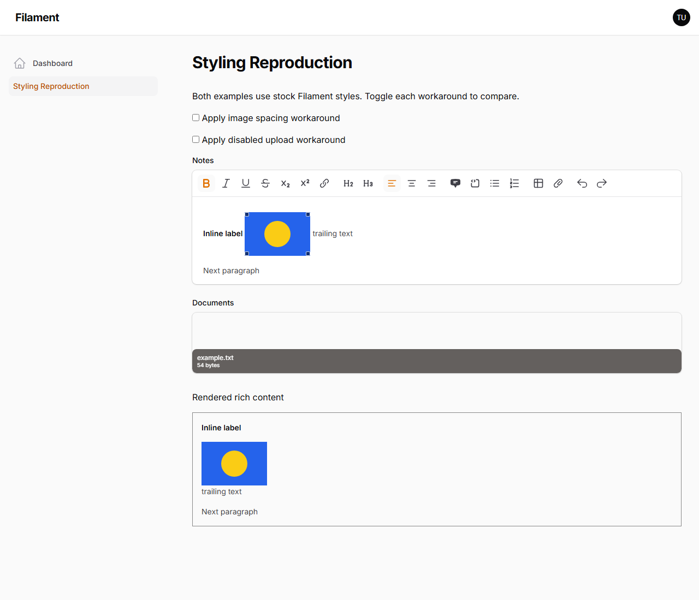
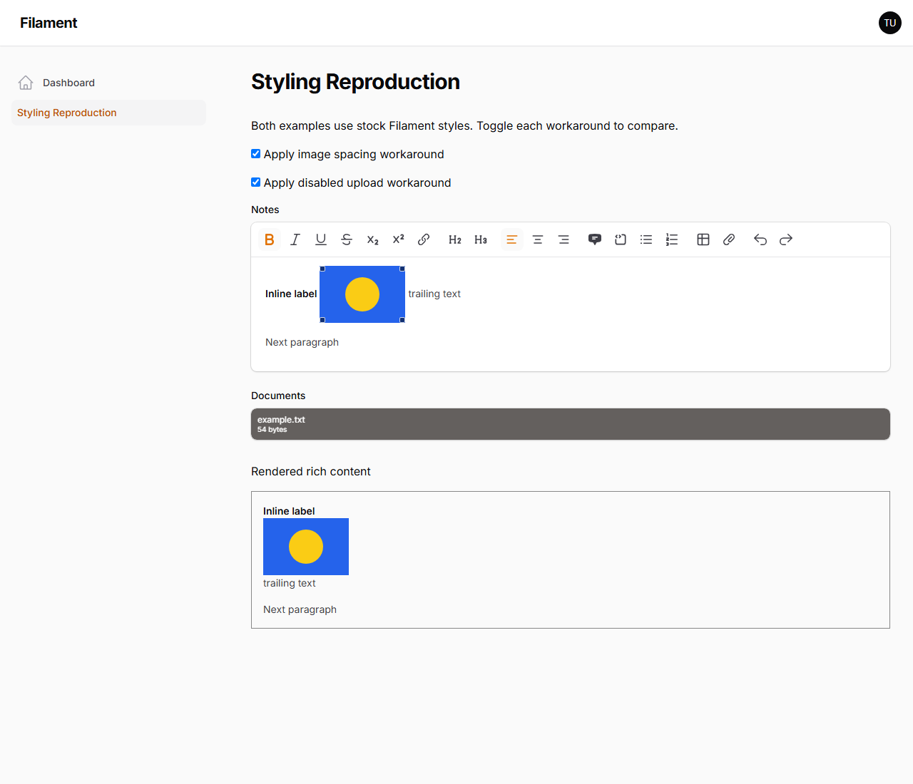

# Filament styling reproductions

Minimal examples of two styling issues on Filament 5.11.1, Laravel 13.40.0, and Livewire 4.4.8. Based on the official Filament 5.x reproduction template. No application data or custom theme is included.

## Setup

```sh
git clone https://github.com/BenjaminRayner/filament-styling-reproduction.git
cd filament-styling-reproduction
composer setup
php artisan serve
```

Log in at `/admin` with `test@example.com` / `password`, then select **Styling Reproduction**. These are the template's local development credentials.

The page is prefilled with synthetic content and creates its own example document on the local disk. No uploads, external image service, media-library plugin, or additional model setup is needed.

## Issue 1: top margin on paragraph images

The rich editor contains a paragraph with bold text followed by a resizable image. The same content is rendered below using `RichContentRenderer`. In Chromium, both the editor resize container and the rendered image receive a computed `margin-top: 16px` from Filament's prose sibling spacing rule.

Toggle **Apply image spacing workaround**. Both margins become zero. The workaround is scoped to paragraph images and resize containers, preserving block spacing.

## Issue 2: empty drop-label area in disabled file uploads

The stock `FileUpload` field is disabled, populated with one document, configured for multiple files, and has previews disabled. Its empty `.filepond--drop-label` remains visible in layout above the file list. In Chromium it reserves approximately 67px, with the whole field measuring 111px.

Toggle **Apply disabled upload workaround**. The page reloads so the CSS is active before FilePond initializes. The empty label is hidden and the field contracts to 44px around its existing file item. Applying the CSS after initialization hides the label but leaves cached layout space until reinitialization. This reproduces without the Spatie Media Library integration.

## Comparison screenshots

These screenshots were captured in headless Chromium at 1280px viewport width on PHP 8.5.12. Both workaround toggles are off initially.

Before:



After:



## Implementation

- `app/Filament/Pages/StylingReproduction.php`: the two field configurations and synthetic initial state.
- `resources/views/filament/pages/styling-reproduction.blade.php`: rendered rich content and optional CSS workarounds.
- `public/example.svg`: a local image fixture.
